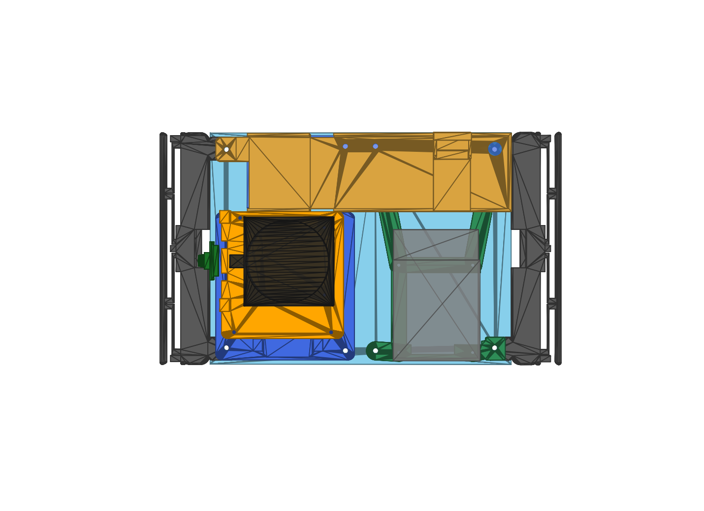
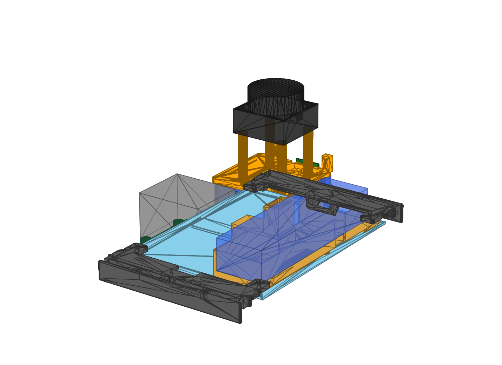
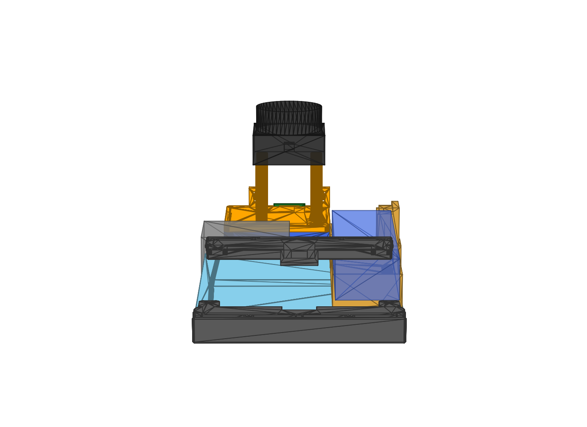
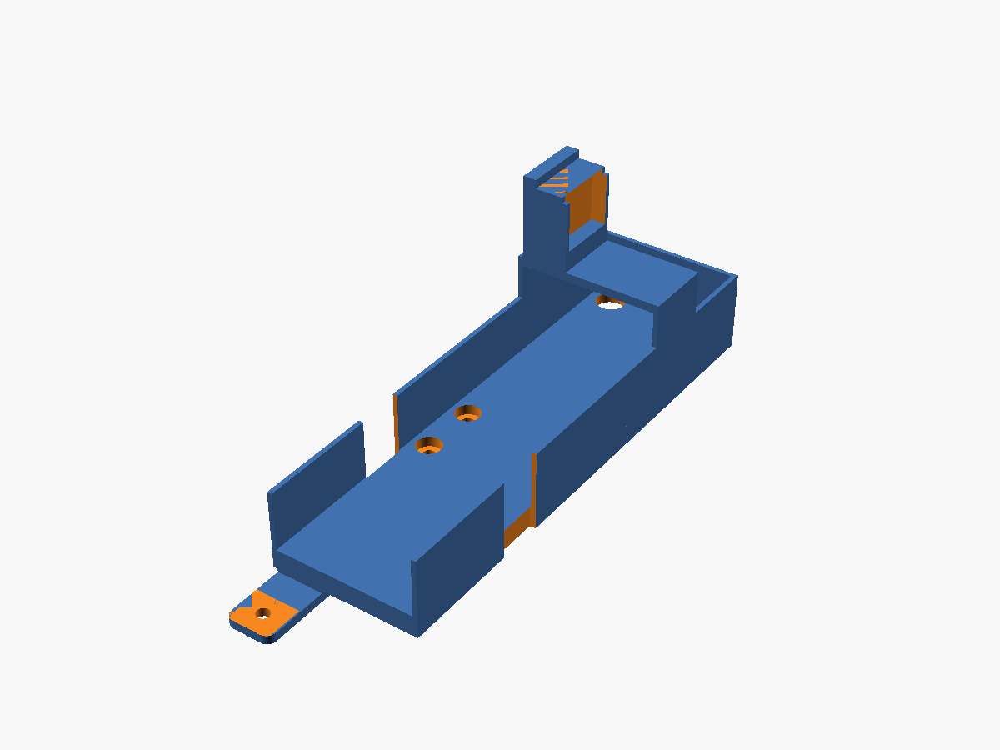

# リポ 3S + RPLIDAR C1 + ラズパイ + 前カメラ マウント（最終版）

> **注**: このファイルはリポ 1 個の形（`power = "lipo"`）の説明。前の形（CIO モバイルバッテリー 2 個）の STL（`box` / `lid` / `cam_mount` / `cc_holder` / `cc_spacer`）はリポ化で使わなくなったため v2.10.7 で削除した。SCAD から `-D 'power="cio"'` で再生成できる（古い STL は Git の履歴）。

天板（154 x 200 mm）に載せる部品。
- 前側: DROK 降圧コンバーター・ヒューズ・WAGO・電源スイッチ 2 個（Pi 用・モーター用）を中に入れる電源箱（`box_lipo`、スイッチは左の端の壁に付け、カバーの左の切り欠きから外から押せる）と、その上に RPLIDAR C1・前カメラ（Raspberry Pi Camera Module 3 Wide SC0874）を載せるふた（`lid_lipo`）
- 右はし: リポ 3S 11.1V 10000mAh（170 × 47 × 31 mm、580 g）1 個を前後に長く置く台（`lipo_tray`）。IMU（GY-BNO055）はリポの上をまたぐ橋の上
- 後ろ側: Raspberry Pi 5 台（AI HAT+ / Motor HAT は Pi の上に重ねる）。Pi は左に寄せ、電源ボタンはカバーの左の穴から押せる

| ファイル | 内容 |
|---|---|
| `battery_lidar_mount.scad` | OpenSCAD ソース（寸法はすべて先頭のパラメーター。`power = "lipo"` がリポの形） |
| `lipo_tray.stl` | リポの台 + IMU の台（いまの向きのまま印刷。床の下（天板から 4 mm）と IMU の橋の下にサポートが要る） |
| `box_lipo.stl` | 電源箱（外 69.5 × 75.2 × 38.4 mm。中は DROK・ヒューズ・WAGO・電源スイッチ 2 個。DROK は床の台に寝かせ、USB-A は後ろの壁の穴から出す。スイッチは左の端の壁にスナップイン） |
| `lid_lipo.stl` | ふた + LiDAR 台 |
| `cam_mount_lipo.stl` | カメラの板（右の耳がリポの台に当たらないよう 22 mm 細い） |
| `pi_base.stl` | ラズパイ台（板を下にして印刷、サポート不要） |
| `bumper.stl` | 前後バンパー（前後共通、2 個印刷。上面を下にした向きで出力済み、サポート不要） |
| `cover.stl` | 上面カバー（Camera Module 3 Wide 用。上面を下にした向きで出力済み、サポート不要。**v2.10.9 で変更**: 左の壁に電源スイッチ用の切り欠きを追加、右の壁の CC スイッチの切り欠き 2 か所と上面の残量表示の窓をなくした。**今のカバーではスイッチが外から押せないので、印刷し直す**） |
| `assembly_lipo.png` / `top_lipo.png` / `side_lipo.png` / `lipo_tray.png` | 組み立てイメージ / 真上 / 横 / リポの台だけ |
| `motor_recess.png` / `bumper_under.png` / `bumper_spring.png` / `bumper_hook.png` / `tof_view.png` / `screw_holes.png` / `cam_post_nut.png` | モーターのネジのくぼみ（下から見た図、左右が反転。赤がネジの範囲） / バンパーを下から / バンパーのばね / バンパーの爪（断面） / 落下防止センサーの視野（横から） / ネジ穴の断面 / ふたの前端の左の柱（M3 の貫通穴と M2 のナットのくぼみ） |
| `wiring.png` / `wiring_front.png` / `wiring_top.png` | 配線経路の目安（後ろ斜め / 前斜め / 真上。`-D show_cables=true` で描画） |
| `camera_mount.png` | Camera Module 3 Wide の取付（前から。白が板） |
| `cam_mount_back.png` / `cam_nut_relief.png` | カメラの板の裏（M2 ナットの六角のくぼみ） / ふた・箱の前の面の逃げ穴（M2 x 10 とナットを入れた状態） |
| `wiring_camera.png` | Camera Module 3 Wide のフラットケーブルの経路（白。`-D show_cables=true`） |
| `drok_inside.png` / `sw_outside.png` | 箱の中の DROK の台と左の端の壁のスイッチ（ふたを外して斜め上から） / カバーの左の壁のスイッチ用の切り欠き |
| `cover_assembly.png` / `cover_right.png` / `cover_rear.png` / `cover_hook.png` | カバーを付けた状態（前のカメラの切り欠き） / 右側面（充電口） / 後ろ斜め（左の壁のスイッチ用切り欠き・Pi ボタンの穴） / フックの断面（`-D show_cover=true` で組立図に描画） |

## ネジ穴

| 場所 | ネジ | 穴の形 |
|---|---|---|
| 天板への取付（箱のフランジ、ラズパイ台の腕、バンパーの腕） | 天板の今のネジ（長いものに交換） | Ø4.4 の通し穴 |
| ふた → 箱のボス（4 か所） | M3 x 12 mm | ふた: Ø3.4 の通し穴 / 箱: M3 のねじ込み穴 深さ 12 mm |
| LiDAR → ふたの柱（4 か所） | M2.5 x 8 mm（C1 に 3 mm 入る。C1 は 4 mm より深く入れない） | 下から座ぐり Ø5.2、上端 5 mm に Ø2.9 の通し穴 |
| Camera Module 3 Wide → 板の支柱（4 か所） | M2 x 6 mm（ナットで留めるときは M2 x 8〜10 mm） | 支柱 Ø4.6・高さ 4 mm に Ø2.5 の下穴（板を貫通）。板の裏に M2 ナットの六角のくぼみ（二面幅 4.4 mm、深さ 1.8 mm、`wcam_nut_af`・`wcam_nut_d`）。ふた（上の 2 本）と箱（下の 2 本）の前の面に、ナットとネジの先の逃げ穴（Ø6.5、深さ 4 mm、`wcam_relief_d`・`wcam_relief_l`） |
| カメラの板の耳 → ふたの前端の柱（左右 2 か所） | M3 x 8 mm | 耳: Ø3.4 の通し穴 / 柱: M3 のねじ込み穴（Ø2.5、柱を貫通） |
| Pi 5 の M2.5 六角支柱（幅 5 mm）→ ラズパイ台のボス（4 か所） | M2.5 x 6 mm（台の裏から支柱のメスねじへ） | 支柱を差し込む丸い穴 Ø6.2 深さ 5 mm、底に Ø2.9 の通し穴、裏から座ぐり Ø5.2 深さ 2 mm |
| DROK 降圧コンバーター → 箱の中の床の台 | ネジなし（床の台の上に載せ、前の隅 2 か所の爪で押さえる） | 基板に取付穴がないため、台（高さ 3 mm）の上に寝かせ、爪で前の縁を押さえる。緩ければ両面テープか結束バンドを足す |
| 電源スイッチ（ミニロッカー 2 ピン） → 箱の左の端の壁 | ネジなし（スナップイン） | 穴 13 × 19.2 mm を 2 個（`sw2_cut`。届いたら実測して直す）。穴のまわりは内側をえぐって厚さ 1.8 mm にしてある（`sw2_wall`・`sw2_pocket`） |
| 上面カバー → 天板 | ネジなし（左右 4 個のフック） | 天板の左右の端の裏に爪（奥行き 2.3 mm）が掛かる |

- ねじ込み穴は `screw_mode` で形を切り替える。どちらも入口に面取りを付ける
  - `"tap"`（既定）: 下穴（M2 Ø1.7 / M2.5 Ø2.1 / M3 Ø2.5）。普通の小ネジをねじ込むと、ネジ自身が樹脂にねじ山を切る。M2〜M3 のねじ山は細かすぎて FDM ではきれいに出ないので、ねじ山は形にしていない
  - `"insert"`: 熱圧入インサート（真鍮）用の穴（M2 Ø3.2 / M2.5 Ø3.6 / M3 Ø4.0）。何度も外すところや、強く締めたいところに向く。穴径はインサートの製品に合わせて `insert_d` を直す
- 下穴がきつい、またはゆるい場合は `tap_d` を 0.1 mm ずつ変える

## 主な寸法

- 電源箱（`box_lipo`）の外形: 69.5 x 75.2 x 38.4 mm（前の形の箱を右から 34.5 mm 縮めたもの）。中には DROK・ヒューズ・WAGO・電源スイッチ 2 個を入れる。前後の壁は 3.8 mm、床は 5 mm（フランジ 3 mm より 2 mm 厚い。下のモーターのネジのくぼみの分）。右の開口からリポの台の線（XT60・バランス）を入れる
- 電源スイッチ（ミニロッカー 2 ピン 2 個）: 箱の左の端の壁に Y 130 / 156 mm・高さ中心 24 mm（`sw2_ys`・`sw2_zc`）でスナップイン。カバーの左の壁の切り欠き（Y 118.5〜167.5 mm、高さ 9.4〜38.6 mm。`cov_sw2`）から指が届くので、カバーを外さずに切り替えられる。後ろ側（Y 130）が Pi 用、前側（Y 156）がモーター用。壁には「Pi」「M」の文字を彫ってある
- フランジ: 縮めた分だけ短い。天板の前側は**左の 2 穴**で留める（右の 2 穴はリポの台が使う）
- LiDAR 取付柱: 高さ 48 mm、太さ Ø8.5。LiDAR 底面の M2.5 ねじ穴に、ふたの裏から柱の中を通したネジで留める（柱の下から Ø5.2 の座ぐりでネジ頭を沈め、上端 5 mm だけ Ø2.9 の通し穴を残す）。座ぐりは柱の下から 47 mm あるので、軸が Ø5 より細く、長さ 50 mm 以上のドライバーを使う。穴位置は C1 のデータシート Figure 4-1（43 x 43 mm の四角、回転中心が真ん中）。前の A1M8（Figure 5-2、ヘッド側 56 mm 間隔、モーター側 40 mm 間隔）の形は `-D 'lidar_model="a1m8"'` で出せる
- LiDAR 取付面の高さ: 天板上面から 90.4 mm（カバーの上面 82.4 mm より 8 mm 上）。C1 の底（55.6 mm 角、高さ 23.1 mm）は取付面の上にあり、光の高さは取付面から 29.8 mm（天板から 120.2 mm）。C1 は取付面より下に出る所がない
- LiDAR の向き: C1 の 0°（ケーブルの出口の反対）を後ろ、ケーブルの出口を前に向ける（`c1_cable_front`）。`scan_angle_offset_deg` −176.2° はこの向きで測った値。柱は 43 mm の正方形なので 90° ずつどの向きでも付くが、向きを変えたら測り直す
- LiDAR の位置: 回転中心は前の形と同じ X 69 mm。`lidar_dx` は箱の中心からの差なので、箱が左へ縮んだ分 −8 → 9.25 に変わっただけ（物理位置は同じ）。ROS の TF（`laser_y`）と `dashboard.yaml` の `camera_offset_*` は変えなくてよい
- Camera Module 3 Wide（SC0874）: 寸法は公式の図面 RP-008155-DS-1 から（実物は未確認）。基板 25 x 23.862 x 1.12 mm、M2 の穴は左右 21 mm 間隔・基板の下の端から 2.0 / 14.5 mm、レンズの中心は下の端から 14.4 mm、レンズは基板の表から 8.3 mm・太さ Ø6.95 mm、画角 横 102°・縦 67°
  - 位置: レンズの中心は X 69 mm（LiDAR の回転中心）・天板から 28.1 mm（実物の付け方。下の「向き」）。基板は天板から 18.6〜42.5 mm、X 56.5〜81.5 mm
  - 向き: 実物はフラットケーブルの端子を下にして付けている（`wcam_fpc_down`。映像はそのままの向きで、ソフトでは回さない）。板の穴は端子を上にする向き（レンズの中心 40.4 mm）で開けたままで、上下を逆にすると基板の端子と反対の端からの穴の位置（2.0 / 14.5 mm）が入れかわるので、レンズは 12.3 mm 下（下の 2 本の穴の高さ 28 mm のほぼ横）になる。ケーブルは下の端子から出て、基板の下の端から 10 mm 下で折り返し（`wfpc_loop`）、板と基板の裏の間（支柱の間）を上へ回して板の上を越え、板のうしろで 20 mm 上へ立ち上がってから（`wfpc_rise`、写真で見える分）ふたの上へ（`wfpc_pts`）
  - 前後: 板（厚さ 2.5 mm）の裏をふたの前端の面（Y 189.6 mm）に当てる。板から高さ 4 mm の支柱（Ø4.6。裏の端子 約 3 mm の逃げ）の先に基板の裏（Y 196.1 mm）。レンズの先は Y 205.5 mm で、カバーの前の壁の内側より 1.0 mm 奥（カバーの中にかくれる）
  - 板: 87 x 33.9 mm（左右の耳はふたの前端の柱 2 本に M3 で留める）。板の上の端は天板から 45.9 mm で、端子から出たケーブルは板の上を越えて後ろへ
  - ナットの逃げ: 板の裏は、上の 2 本（天板から 40.5 mm）がふた（38.4 mm から上）、下の 2 本（28 mm）が箱の前の面に当たる。M2 x 6 mm のネジの先は板の裏から出ないが、ナットで留めると出るので、板の裏に M2 ナットが入る六角のくぼみ（二面幅 4.4 mm、深さ 1.8 mm。厚さ 1.6 mm のナットが裏から出ない）を開け、ふたと箱の前の面にナットの角とネジの先の逃げ穴（Ø6.5、深さ 4 mm）を開けた。M2 x 10 mm でもネジの先は逃げ穴の底の 1.6 mm 手前。箱の前の壁は逃げ穴の後ろに 1.8 mm 残る。ナットとネジがふた・箱と重ならないことを OpenSCAD で確かめた
  - 届いたら実測して直すところ: レンズの長さ（`wcam_lens_l`）、裏の端子の厚さ（`wcam_conn`）、穴の位置（`wcam_hole_z`）
- 板・ふたの柱の位置の基準（`scam_*`）: 前に付けていた USB 2 眼カメラ（今は使わない）の寸法から決めた位置を、今の板・ふたの前端の柱 2 本（M3）・柱の前の面の M2 ナットのくぼみ（`scam_nut_af`・`scam_nut_d`）にそのまま使っている。変えると板・ふた・カバーの位置が動く
- ラズパイ 3 段（Pi 5 + AI HAT+ + Motor HAT、実測 45 mm）: 台のボスで最大 9 mm 高くなっても上端は約 54 mm。LiDAR 取付面（90.4 mm）より低く、LiDAR ヘッドとは前後に約 30 mm 離れる
- IMU（GY-BNO055）: 基板 12 x 20 mm（`imu_board`）。リポの台の橋の上の台（`imu_mast()`、リポの台といっしょに印刷）に、長辺を前後にして載せる（基板の中心 `imu_c` = [143, 40]、基板の下面は天板から 70 mm（`imu_z`）。位置・向きは前の形と同じで、ROS の TF・`imu.yaml` は変えなくてよい）。LiDAR のヘッドの中心から約 128 mm 離してある（LiDAR が回ると磁気が大きくゆれたので、磁石の影響を距離で下げた。強さのばらつき ±13 µT → 計算では 1/200 以下）。ピンヘッダーは下向きで -X 側（Pi 側）の長辺に並ぶ。台はその側を開け、ピンとジャンパー線の差しこみ（14 mm）が下がる溝を -X 側へ抜いた（溝の下は 52.7 mm まで約 3 mm）。基板は -X 側から横に差しこみ、+X 側の縁を壁の上のつめ（内側へ 3 mm、厚さ 3 mm。`imu_lip`・`imu_lip_t`）の下に入れる。台の上端は 74.9 mm で、カバーの裏（80 mm）まで約 5 mm。IMU の軸の設定は `axis_map_config: 0x21`・`axis_map_sign: 0x04`（基板の x が左・y が後ろ）
- モーター取付ネジのくぼみ: 天板の上にモーター取付ネジの頭が 3 mm 出ている範囲（28 x 28 mm が 4 か所。左右の端から 7 mm、前後の端から 38 mm、`motor_scr_pts`）の上に載る部品の底に、深さ 3.5 mm・29 x 29 mm のくぼみ（ネジとのすき間は横と上に 0.5 mm、`recess_clr`）を付けた。くぼみの上には 1.5 mm 残す（`recess_roof`）ので、くぼみのある部分は厚さ 5 mm（`recess_t`）
  - 前の 2 か所（Y 134〜162 mm）: 電源箱。床を 5 mm にし、フランジだけの左右の部分にも厚さ 5 mm の台（くぼみの周り 1.5 mm）を足した。左の結束バンドの受け 2 個は、くぼみの前後（Y 128 / 168 mm）へずらした
  - 後ろ左・後ろ右: ラズパイ台の腕と Pi の受けはネジの範囲にかからない（液晶の台をなくしたので、後ろ左もくぼみはいらない）
  - 高さが 3 mm より高いネジ、または範囲からはみ出すネジがあれば、`motor_scr_h` / `motor_scr_pts` を直して STL を作り直す
- バンパー: 天板の端から 33 mm 前（後ろ）に出す（`bump_out`）。固定側（腕 + 板 + センサー受け）と前面の板を分け、横長の板ばね 4 枚（有効長 30 mm、板厚 0.8 mm）でつなぐ。板ばねは片端を固定側、反対の端を前面の板につなぎ、向きを交互にして前面の板が平行に動くようにしてある。ぶつかると前面の板だけが後ろへ 4 mm 逃げ（`bump_travel`）、ストッパー 3 本（長さ 6.8 mm）に当たって止まる。止まったときも、板ばねと固定側・前面の板のあいだには 1 mm のすき間が残る（`spring_clr`）。前面の板は天板上面から 15 mm 下まで伸ばす（`bump_drop`）。手で触る縁（上の板の上下の縁と角、前面の板の上下左右の縁）は 1 mm の面取り（`bump_edge`）。左右の腕の下に爪（X 7.2〜18 mm と 136〜146.8 mm、高さ 3 mm、`bump_hook_x`）があり、前は箱のフランジの前の縁（Y 196 mm）、後ろはラズパイ台の腕の端（Y 4 mm、平らにしてある）に 0.1 mm のすき間（`bump_hook_clr`）で当たる。ぶつかったときの力は、ネジではなくこの左右 2 か所の面（11 × 3 mm）で受ける
  - 4 mm 逃げたときの曲げひずみは約 1.1%（`spring_strain`、3 t δ / L² による）。PLA の降伏ひずみ（約 2%）の半分ほどなので、PLA で印刷できる（PETG でもよい）。板ばねは印刷の層に沿って曲がる向き。全体の反力は計算上 約 8 N（PLA）。硬さは `spring_t` と `spring_x`（板ばねの長さ）で変えるが、変えたら `spring_strain` が PLA で 1.2% を超えないことを確かめる
  - 一体で印刷でき、組み立ては不要
  - 固定: 前は箱のフランジ、後ろはラズパイ台の腕の上に重ね、四隅の穴で共締め（ネジはさらに 4 mm 長く）。腕は箱のボスを避けて左右 15 mm 幅
  - センサーは固定側に付いているので、ぶつかっても向きは変わらない
- 落下防止センサー（VL53L1X、Dovhmoh 25 x 10.7 x 3.2 mm）: バンパー中央の下に付けた斜めの受けに、上から落とし込む。真下から進行方向へ 45° 傾けて前方の床を見る（`tof_tilt`）。受けの中心は天板の端から 14 mm 前、天板上面から 5 mm 下（`tof_dy`、`tof_drop`）。45° にしても上から落とし込む穴が天板の角・箱のフランジにかからない位置まで前へ出してある。基板の下面のレンズのカバー（実測 12.2 x 7.4 mm、`tof_cover`。中心は基板の中心から約 1.9 mm ピンと反対側へ寄り、縁は基板の長辺まで来る）が入るよう、窓は幅 13.4 mm（`tof_win`）で、長辺の方向は受けの穴いっぱいに開けた。基板は左右の耳（丸穴の部分、各 5.8 mm）で受け、丸穴の部分は開けていない。窓の上下は対称なので、ピンの列がどちら側でも入る。ピンは上向きで、配線は同じ穴から上へ出す。視野は前面の板の下を通る
  - 床を見る位置は、センサーから前へ「床までの高さ x tan 45°」＝床までの高さと同じ距離（バンパーの前面はセンサーの 19 mm 前）。測る距離は高さの約 1.41 倍（最短 4 cm）
  - 視野 27° の上の端は、前面の板の下端より約 3 mm 下を通る（`tof_view.png`）。55° を超えると上の端が前面の板に近づき、60° で当たる
  - 30° から 45° に変えた理由: 30° では床を見る位置がバンパーの前面から 1〜3 cm 先しかなく、0.3 m/s（手動の最高速度）では止まるのが間に合わない。45° なら、床から天板の下面まで 70 mm（実測）で、床を見る位置はバンパーの前面から約 5 cm、前輪の接地点から約 14 cm 先（前輪の車軸は天板の前端から約 52 mm 後ろ。OSOYOO のシャーシの図面）
  - VL53L1X の I2C アドレスは初期値 0x29 で、2 個とも同じ。GY-BNO055（0x29 で使用中）とも重なるため、XSHUT をそれぞれ GPIO につないで起動時にアドレスを変えるか、BNO055 を 0x28 に戻す必要がある
- DROK 降圧コンバーター（B09JKHD3SH、12V → 5.2V / 5A、USB-A 出力）: 基板 63 x 27 mm（商品画像の寸法）、基板の裏から部品の頂点まで 13 mm と仮定（`drok_board`、`drok_h`）。取付穴がないので、箱の中の床の上の台（高さ 3 mm、`drok_pad_t`）に、長辺を前後・短辺を左右にして寝かせる。位置は X 59.5〜86.5 mm・Y 116.5〜179.5 mm（`drok_in_x`・`drok_in_y0`。後ろの寄りで、左の端の壁のスイッチの逃げより右）
  - 前の隅 2 か所を、高さ 11 mm の柱の上に出した爪（`drok_clip`）で押さえる。基板の裏のピンは台の高さで逃がす。緩ければ両面テープか結束バンドを足す
  - USB-A 出力の端は後ろの壁側。壁の穴（幅 15 × 高さ 9 mm、仮の寸法 `drok_usb`・`drok_usb_z0`。実物で確かめて直す）から USB-A プラグを差し込み、後ろへ回して Pi へ。後ろの壁の下の切り欠き（X 40〜58 mm、高さ 13 mm まで。`drok_wire_x`・`drok_wire_z`）はモーターの線・センサーの線の出口
  - 入力（VIN+・VIN− のねじ端子台）は USB-A と反対側（前側）で、ヒューズ→スイッチからの線を箱の中で留める
- ラズパイ台: Pi 5 の穴（58 x 49 mm）に高さ 6 mm のボス（Ø9.4）。Pi に付けた M2.5 の六角支柱（幅 5 mm）を、ボスの丸い穴（Ø6.2、六角の角と角の間 5.77 mm より大きいので、支柱を回さずに差し込める）に 5 mm 差し込み、台の裏から M2.5 x 6 mm のネジで留める（ネジ頭は裏の座ぐり Ø5.2 深さ 2 mm に沈む）。Pi の基板の下面の高さは `pi_z` = 台の上面 + 6 − 5 + 支柱の長さ `pi_so_l`。カバーの上面の裏（80 mm）に当たらない支柱の長さは 31 mm まで。天板の後ろ側 4 穴（四隅 2 個 + 後端から 90 mm の 2 個）に 4 本の腕で留める。USB / LAN は右（+X）、GPIO は前向き。基板の中心は X 47 mm（`pi_cx`）で、基板の左の短辺（電源ボタン・microSD 側）は X 4.5 mm（カバーの左の壁の内側から 4.8 mm）、右の短辺は X 89.5 mm。USB / LAN の口（基板から約 4 mm 出る）からカバーの右の壁の内側（X 154.3 mm）まで約 61 mm あくので、ストレートの USB プラグ（長さ約 40 mm を見込んだ箱）でもカバーに当たらない（OpenSCAD で確認）。台は Pi の受け 4 か所・腕 4 本・モーター線の開口だけで、Pi のまわりにほかの部品はない

## 配線

経路は `wiring*.png`（`-D show_cables=true`）。寸法はデータシート（RPLIDAR A1 Figure 5-2、Raspberry Pi 5 機械図面）からの読み取りで、実物では確かめていない。

| 配線 | 経路 | 確保してある寸法 |
|---|---|---|
| Camera Module 3 Wide（フラットケーブル 22 ピン → 15 ピン、幅 16 mm） | 基板の裏の下の端子 → 下へ出して基板の 10 mm 下で折り返し、板と基板の裏の間を上へ → 板の上を越え、板のうしろで 20 mm 立ち上がってからふたの上を後ろへ（LiDAR の前の柱 2 本の間）→ Y 170〜184 mm で 2 回折って右へ 16 mm → 結束バンド用ブリッジ 2 か所（X 77・Y 166、X 86・Y 119.4）の上 → 後ろ右の柱の左 → ふたの後ろ端から DROK の上へ下りる → Pi 3 段の前から Pi と AI HAT+ の間を通して Pi の CAM の口へ | 経路は約 29 cm。**30 cm** のケーブルを使う（15 cm 以下は届かない） |
| LiDAR（ハーネス + USB 変換基板 → Pi の USB） | 変換基板はふたの上、ヘッドの下（基板部の下に約 15 mm の空き）の左寄り（X 72 mm より左。右はカメラの USB ケーブル）に両面テープで貼る。ハーネスと USB ケーブルは右へ回し、ふたの後ろ端の結束バンド用ブリッジ（X 86 mm）で留め、Pi 右側の USB-A へ | USB-A の差し込み側は天板の右端まで約 30 mm。L 字の USB プラグを推奨 |
| リポ → WAGO A・B → ヒューズ 5A → スイッチ → DROK の VIN+・VIN− | リポの XT60・バランス線は台の前の面から出し、前の約 15 mm で曲げて左の電源箱の右の開口へ。ヒューズ・WAGO・スイッチ・DROK はすべて箱の中。スイッチは左の端の壁の後ろ側の穴（Y 130）にスナップインし、箱の中で DROK の前側の VIN+・VIN− ねじ端子台（18AWG）へ | 線のくわしい番号・つなぐ順番は `docs/power/lipo_wiring.html` |
| DROK の USB-A → Pi 5 の USB-C | DROK（箱の中、後ろの寄り）の USB-A → 後ろの壁の穴から出して後ろへ → Pi 後ろ側の USB-C | USB-A の穴は箱の後ろの壁（X 65.5〜80.5 mm、高さ 9〜18 mm。仮の寸法。実物で確かめる）。30 cm 程度の USB-A → USB-C（C 側は L 字を推奨） |
| リポ → WAGO A・B → ヒューズ 7.5A → スイッチ → Motor HAT | ラズパイ側と同じ WAGO A・B から分ける。スイッチは左の端の壁の前側の穴（Y 156）。後ろの壁の下の切り欠き（`drok_wire_x`）から出して、右側から後ろへ回して Motor HAT 後ろ端の端子台へ | Pi の後ろ（Y 0〜22 mm）は空けてある |
| モーター線（4 本） | 天板の開口 → ラズパイ台の中央開口（後ろの縁まで開けてある）→ Pi の後ろ → Motor HAT の端子台 | 開口 48 x 50 mm（後ろ側は台の縁まで） |
| IMU（I2C 4 本） | ピン下向き → 台の -X 側の溝から左へ出す → Pi の上を前へ → Pi の前の GPIO ヘッダー（1・3・5・9 番）へ | 約 15 cm（20 cm のジャンパー線） |
| 前の VL53L1X（5〜6 本） | 受けの穴から上へ → バンパー上面を左へ → フランジ左の結束バンド用ブリッジ 2 か所 → 箱の後ろから GPIO ヘッダーへ | 約 27 cm（30 cm のジャンパー線が必要） |
| 後ろの VL53L1X（5〜6 本） | 受けの穴から上へ → Motor HAT の上を通って GPIO ヘッダーへ | 約 15 cm |

- ピン配置と長さはすべて推定。VL53L1X・IMU のピンの位置、LiDAR の USB 変換基板の大きさは実物に合わせて見直す
- バンパーの前面の板は動くが、センサーは固定側にあるので配線は引っ張られない
- 結束バンド用ブリッジは幅 3.6 mm までの結束バンドが通る（`tie_w`）
- DROK の大きさ・部品の高さ・裏のピンの位置は商品画像からの推定。届いたら実測して `drok_board`・`drok_h`・`drok_in_x`・`drok_in_y0`・`drok_usb`（USB-A の穴）を直す。電源スイッチのパネル穴も実測して `sw2_cut` を直す |

## 組み立て（リポの形）

1. 電源箱（`box_lipo`）を天板の前側の**左の 2 穴**に、フランジの厚さ（3 mm）ぶん長いネジで留める（右の 2 穴はリポの台が使う）
2. リポの台（`lipo_tray`）を天板の右はしに置き、[145, 110]・[145, 90]（ラズパイ台の腕と共締め）・[143, 189]（前のバンパーの腕の下の板）の 3 か所で留める。リポの下に来るネジは頭の高さ 2.2 mm くらいの M4 低頭ネジにする。留める前に面ファスナー（幅 16 mm まで）を床の下の 4 mm のすき間に通しておく
3. LiDAR をケーブルの出口を前にしてふたの柱に載せ、ふたの裏から柱の中に M2.5 x 8 mm のネジを通して 4 か所留める（ふたを箱に付ける前に行う。C1 には 3 mm 入る。座ぐりは柱の下から 47 mm あるので、軸が Ø5 より細く長さ 50 mm 以上のドライバーを使う）
4. ふたを M3 x 12 mm のネジ 4 本で箱のボスに留める
5. Camera Module 3 Wide を端子を下にして、先にフラットケーブルの 15 ピン側（太いほう）を差してから、板（`cam_mount_lipo`）の支柱に前から M2 x 6 mm で 4 本留める（ナットで留めるときは M2 x 8〜10 mm にして、ナットを板の裏の六角のくぼみに入れる。ナットとネジの先は、ふた・箱の前の面の逃げ穴 Ø6.5・深さ 4 mm に入るので、ふたの組み上げに当たらない）。板の裏をふたの前端の面に当て、左右の耳をふたの前端の柱に M3 x 8 mm で留める。ケーブルを LiDAR の前の柱の間からふたの上の結束バンド用ブリッジで通し、22 ピン側（細いほう）を Pi の CAM の口へ
   - IMU はピン下向き・ピンヘッダーを左（Pi 側）にして、ジャンパー線を差したままリポの台の橋の上の台に左から横に差しこみ、右の縁を壁の上のつめの下に入れる。浮く場合は両面テープで 1 点留める
6. Pi 5 に付けた M2.5 の六角支柱 4 本をラズパイ台のボスの丸い穴に 5 mm 差し込み、台の裏から M2.5 x 6 mm のネジで留める（台を天板に付ける前に行う）。ラズパイ台を天板の後ろ側 4 穴に長いネジで留める
7. 電源スイッチ 2 個（配線済み）を、左の端の壁の穴に箱の中からスナップインで留める（後ろ側が Pi 用、前側がモーター用。押したときカチッと掛かることを確かめる）。DROK を USB-A の端を後ろの壁に向けて床の台に載せ、前の隅を爪の下に入れる。ヒューズ・WAGO は床に面ファスナーなどで留め、箱の中で配線を済ませる（ふたを付ける前に行う）
8. リポを台の前の開いた側から IMU の橋の下へ差し込み、床の下に通した面ファスナーをリポの上で留める。線（XT60・バランス）は前の面から出し、前の約 15 mm で曲げて左の電源箱の右の開口へ回す（後ろは IMU の橋がリポの浮き上がりを止める）
9. 落下防止センサー（VL53L1X）をバンパーの受けに入れ、バンパーを前後に重ねて共締めする
10. 上面カバーを、充電口が右に来る向きで被せる。右側を先に斜めに入れて右前の固定の爪を天板の裏に掛け、左側をフックがカチッと掛かるまで押し下げる。外すときは左の指かけを外へ引きながら左側から持ち上げる。電源スイッチはカバーの左の壁の切り欠きから指で押せる（後ろ側が Pi 用、前側がモーター用。壁に「Pi」「M」の文字）

## 上面カバー

天板の上の部品全体を覆う一体のカバー。工具を使わず、左右のフックで天板の端の裏に引っかけて留める。

- 外形: 約 164 x 212 x 88 mm（フックと指かけを含む）。Creality K1C（220 x 220 x 250 mm）で一体で印刷できる。上面を下にして印刷し、サポートは不要（`cover.stl` は X 軸まわりに 180° 回して上面を下にしてある。鏡に写した形ではないので、文字も充電口の位置も組立図と同じ）
- 高さ: 上面の裏が天板から 80 mm、外側は 82.4 mm（Pi の 3 段の上端 54 mm の上に 26 mm）。LiDAR の取付面（90.4 mm）はカバーの上面より 8 mm 上にあり、LiDAR は全部カバーの上に出る。柱は、カバーの抜きの中に入る（抜きは A1M8 のときの形のまま。C1 の柱も中に入るので、カバーは印刷し直さなくてよい）
- 付け外し:
  - フック 4 個（左は Y 54 / 170 mm、右は Y 44 / 170 mm。左の後ろは Pi の電源ボタンの穴をよけて天板の後ろの端から 54 mm、右の後ろは CC スイッチの切り欠きをよけて 44 mm、前は前の端から 30 mm、幅 12 mm）。両側に 1 mm の切れ目を入れ、下端から 28 mm がたわむ
  - 右前（Y 170 mm）のフックは充電口の下の細い帯（高さ約 7 mm）にあり、たわませる長さが取れないので、切れ目のない固定の爪にした（`cov_hook_fixed`）。付けるときは右側を先に斜めに入れて右前の爪を天板の裏に掛け、そのあと左側を押し下げる。外すときは左の指かけを外へ引いて左側から持ち上げる
  - 爪の上面は平らで、天板の裏（下面から 0.2 mm）に掛かる。下面は斜めなので、押し下げると天板の端に当たって外へ逃げる
  - 外すときは、爪の外側の指かけを外へ引いて持ち上げる
  - 天板の上面には受け（幅 8 mm）が載って高さが決まる。フックの両隣（フックの中心から前後に 12 mm）と中央（Y 100 mm）に置き、爪と受けで天板の端をはさむ。左は Y 42 / 66 / 100 / 158 / 182 mm、右は Y 60 / 84 / 100 / 158 / 182 mm の 5 か所ずつ（`cov_stop_y`）。前後の位置はフックと前後の壁で決まる（中の柱（ふたの前後の縁をはさむリブ 4 本）は取った）
- LiDAR: LiDAR の外形（ヘッド、柱 4 本、モーター側）より大きく上面を抜いてある。LiDAR を付けたまま、カバーを真上へ抜ける
- 開けた穴:
  - 充電口（右側面、Y 113〜185 mm、高さ 5〜38 mm）: 前のバッテリーの USB-C 用だった穴。リポの形では使わないが、リポの台の右の壁の外に開き、バランス線の引き出し・中の確認に使えるので残してある
  - カメラの切り欠き（前面、Camera Module 3 Wide）: レンズの中心（X 69 mm）から左右 20 mm（幅 40 mm）を、壁の下の端から 40.4 mm まで切り欠いた（`cov_cam_cut`）。レンズの中心は 28.1 mm で、画角の線は壁の外側で 19.8〜36.4 mm を通る。その上の窓（`wcam_win()`）はやめて壁にした
  - 電源スイッチ用の切り欠き（左の壁、Y 118.5〜167.5 mm、高さ 9.4〜38.6 mm。`cov_sw2`）: 箱の左の端の壁のスイッチ 2 個（後ろが Pi 用、前がモーター用。壁に「Pi」「M」の文字）に指が届く。カバーを外さずに電源を切り替えられる
  - 通気口（Pi の上、六角 Ø4.8 を約 90 個）
  - Pi 5 の電源ボタンの穴（左の壁、Y 22〜40 mm・天板から高さ 7〜18 mm、角の丸い 18 x 11 mm）。カバーの外の面からボタンまで約 7 mm なので、指先か、ペンの後ろなど細い棒で押す。ボタンの位置は Pi 5 の機械図面に寸法がないため、「左の短辺の、USB-C の長辺から 0〜18 mm」と広めに見込んだ（`pi_btn_y`、`pi_btn_z`）。印刷したら、穴からボタンが見えるか確かめる
  - なくした穴: CC スイッチの切り欠き（右の壁、2 か所）と、前のバッテリーの残量表示の窓（上面）は、リポの形では使わないのでなくした（前の形に出すときは `power = "cio"`）
  - 後ろの壁の下の切り欠き（X 66〜90 mm、天板から高さ 21 mm まで、角の丸み 3 mm。`cov_rear_cut`）: 後ろの線の出口
  - 前後の壁の下端は天板から 11 mm。バンパーの上面（7 mm）とのあいだを VL53L1X の線が通る
- 見た目: 上面の角を面取りし、後ろを斜めに落とした形。手で触る縁（外側の角と稜線、壁の下端、充電口のふち）は 1 mm の面取り（`cov_edge`。外形の大きさは変わらない）。上面の右前に「AI-CAR」の文字（深さ 0.8 mm）
- ぶつからないこと: 天板・箱・ふた・ラズパイ台・バンパー・LiDAR・カメラ・IMU・DROK・センサー・Pi・バッテリーの外形と、付けた状態で重ならないこと、真上へ抜くときに当たらないこと（フックの爪は除く）を OpenSCAD で確かめた

## リポの台と電源箱の寸法（`power = "lipo"`）

リポ 3S 11.1V 10000mAh（170 × 47 × 31 mm、580 g）1 個を、天板の右はしに前後に長く置く形。

**印刷するのは `lipo_tray` / `box_lipo` / `lid_lipo` / `cam_mount_lipo` / `cover` の 5 部品**（v2.10.9 でカバーにスイッチ用の切り欠きを足し、CC スイッチの切り欠きと残量表示の窓をなくしたので印刷し直す）。ラズパイ台・前後バンパー・試験台は今のものをそのまま使う。前の形で外して使わなくなった部品（`box` / `lid` / `cam_mount` / `cc_holder` / `cc_spacer`）は削除済み。






- リポの台: 外 X 101.5〜152.5、Y 1〜174.4。リポは床（天板から 11 mm）の上にのり、上の面は 42 mm。前は開いていて、リポは前から IMU の橋の下へ差し込む。線（XT60・バランス）は前の面から出し、前の約 15 mm で曲げて、左の箱の右の開口（ヒューズ・WAGO）へ回す
- 床の下は 4 mm あけて、モーターのネジの頭（3 mm）とラズパイ台の腕（3 mm）の上を越える。後ろのバンパーの腕（Z 3〜7 mm）の所は床を切りかき、その腕のネジ（[143, 11]）の頭の所は床を丸く抜く
- リポの下にくるネジは、頭の高さ 2.2 mm くらいの M4 の低頭ネジ（ボタンキャップ）にする。台を留める 2 本（[145, 110]・[145, 90]）は床に座ぐり（Ø8.5、深さ 3.5 mm）があり、頭がリポに当たらない
- 天板への取付: 右の穴 [145, 110]（足）、[145, 90]（ラズパイ台の腕の上で共締め）、[143, 189]（前のバンパーの腕の下の板。もとの箱のフランジの代わり）
- IMU: 位置（X 143、Y 40、高さ 70 mm）と向きは前の形と同じ。リポの上をまたぐ橋の上に同じ形の IMU の台をのせる。ROS の TF・`imu.yaml` は変えなくてよい
- LiDAR: 回転中心（X 69）は前の形と同じ（`lidar_dx` を −8 → 9.25 に変えたのは、箱の真ん中が左へ動いた分。物理位置は同じ）。TF・カメラの位置も変えなくてよい
- 面ファスナー（幅 16 mm まで）1 本: 左右の壁を Y 117〜133 で切ってあり、台を天板に留める前に床の下（4 mm のすき間）に通しておき、リポの上で留める。後ろは IMU の橋がリポの浮き上がりを止める
- ふたの右後ろのネジは、LiDAR の右後ろの柱（Y 115）から離すため、Y 125.4 に置く
- 重なりの確認: OpenSCAD で、リポの台とリポを、箱・ふた（LiDAR の柱）・ラズパイ台・ラズパイ・DROK・カメラ・センサー・バンパー・上面カバー・リポの下のネジの頭とそれぞれ `intersection()` して、重なりがない（面がふれるだけ）ことを確かめた。LiDAR の柱とふたのネジの頭も重ならない
- 気をつけること:
  - ラズパイの USB・LAN の口（右の端 X 約 93.5）とリポの台の壁（X 101.5）の間は約 8 mm。まっすぐの USB プラグはささらないので、L 字（上か下に曲がる）のプラグにする
  - リポの寸法は商品ページの値。届いたら測りなおして `lipo_bat` を直す
  - 上面カバーは新しい `cover.stl` を印刷し直す（左の壁にスイッチ用の切り欠き。今のカバーのままでは外からスイッチを押せない）

## ぶつかりの確かめ（自動）

STL を作り直したら、リポジトリの一番上で次を 1 回実行する（OpenSCAD 2021.01 以上、8 コアで約 3 分）。

```bash
python3 hardware/3d/check_interference.py --power lipo # リポの形だけ
python3 hardware/3d/check_interference.py              # リポと前の形（cio）の両方
```

- 組み立てた位置の部品（天板・箱・ふた・ラズパイ台・バンパー・カバー・リポの台。`power = "cio"` では CC スイッチの台も）、買う部品の形（LiDAR・ラズパイ・カメラ・DROK・電源スイッチ・センサー・TOF・電池）、ネジの頭（ふたの M3、天板の M4）を 2 つずつ `intersection()` で重ねて、重なりの体積を出す
- 重なりが 0.5 mm³ 以下（面がふれるだけ）は ○。それより大きいと `x` を出して、終了コード 1
- わざと重ねている組は、スクリプトの `ALLOWED` に重なりの上限（mm³）と理由をつけて書く（`-` で出る）。形が変わって上限をこえたら `x`
- 先に部品を 1 つずつ形にして、空の部品（名前のまちがい・形が消えた）や OpenSCAD の ERROR があれば `!` で失敗にする
- ネジの頭は `screw_heads()`（スクリプトの中）。ネジの場所を変えたら、ここも直す
- 部品を足したら `SOLIDS`（印刷する部品）か `GHOSTS`（買う部品・ネジ）に足す

## 変更しやすいパラメーター

- `power`: `"lipo"`（最終版）/ `"cio"`（前の形。STL は削除したが再生成できる）
- `lipo_bat`: リポの寸法（商品ページ 170 × 47 × 31 mm。実物で測りなおしたら直す）
- `open_end`: 電源箱の開口側（`"right"` / `"left"`。リポの台側の開口）
- `lidar_tower_h`: LiDAR の高さ
- `lidar_motor_front`: LiDAR のモーター側を前に向けるか
- `lidar_dx`: LiDAR の横位置（カメラは LiDAR の回転中心に左右をそろえるので一緒に動く。ROS の `camera_offset_*` と URDF も直す）
- `wcam_*`: Camera Module 3 Wide の基板・穴・レンズ・裏の端子の寸法と、支柱の高さ（`wcam_so`）
- `scam_board`、`scam_hole_in`、`scam_back_h`、`scam_usb_room` など: 板・ふたの前端の柱の位置の基準（前の 2 眼カメラの寸法から決めた。今の板・ふたもこの位置を使う）
- `imu_c`・`imu_z`: IMU の基板の中心と下面の高さ（リポの台の橋の上。カバーの裏と Pi・LiDAR をよける）
- `bat_disp`: 前のバッテリーの残量表示の窓の位置（前の形のカバーの窓。リポでは使わない）
- `screw_mode`（`"tap"` / `"insert"`）、`tap_d`、`insert_d`、`mount_hole_d`: ネジ穴の形と径
- `pi_btn_y`、`pi_btn_z`: カバーの左の壁の電源ボタンの穴の範囲（Pi の基板から。ボタンが穴の端にかかるときに変える）
- `cov_hook_lip`、`cov_hook_root`: カバーのフックの掛かり（深さ）と、たわむ長さ（きつい・ゆるいときに変える）
- `cov_chg`: カバーの右側面の充電口の位置と大きさ（前のバッテリーの USB-C 用。リポでは使わない穴）

STL の再生成（リポの形・最終版。CIO の形の `box` / `lid` / `cam_mount` / `cc_holder` / `cc_spacer` は v2.10.7 で削除したが、`-D 'power="cio"'` を足せば同じソースから出せる）:

```
openscad -D 'part="lipo_tray" power="lipo"' -o lipo_tray.stl battery_lidar_mount.scad
openscad -D 'part="box" power="lipo"' -o box_lipo.stl battery_lidar_mount.scad
openscad -D 'part="lid" power="lipo"' -o lid_lipo.stl battery_lidar_mount.scad
openscad -D 'part="cam_mount" power="lipo"' -o cam_mount_lipo.stl battery_lidar_mount.scad
openscad -D 'part="pi_base"' -o pi_base.stl battery_lidar_mount.scad
openscad -D 'part="bumper"' -o bumper.stl battery_lidar_mount.scad
openscad -D 'part="cover"' -o cover.stl battery_lidar_mount.scad
```
